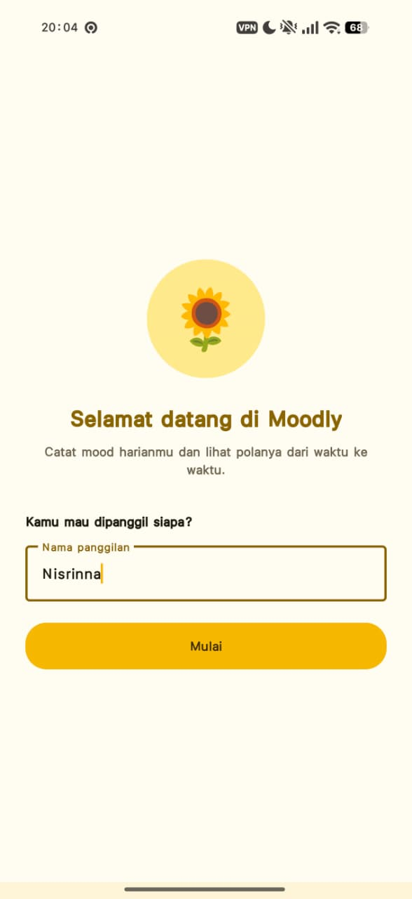
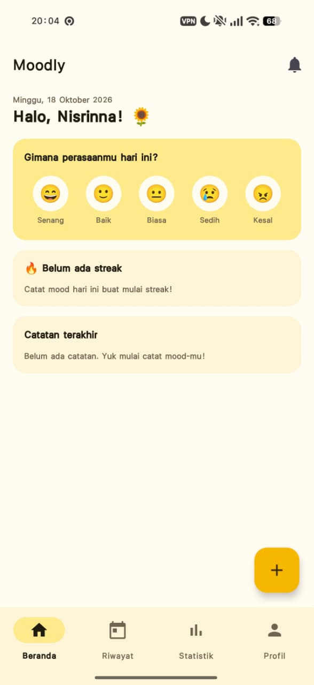
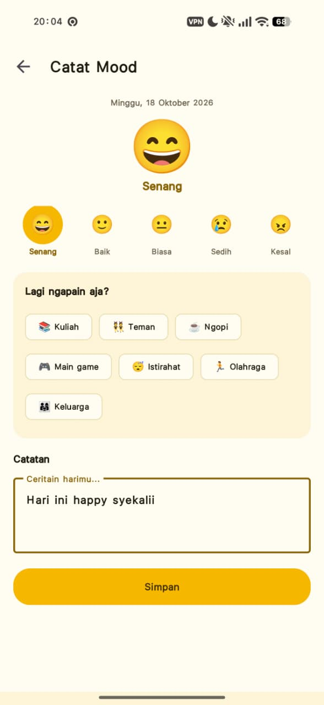
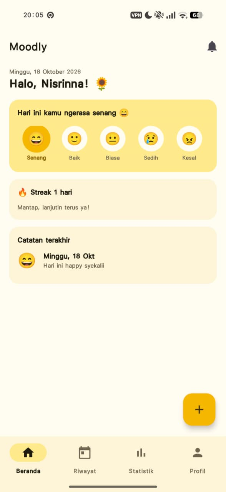
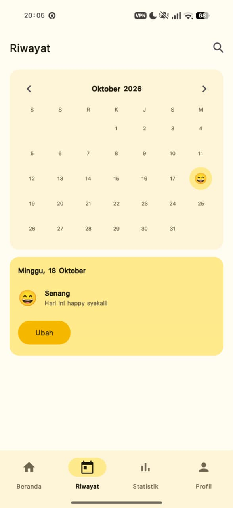
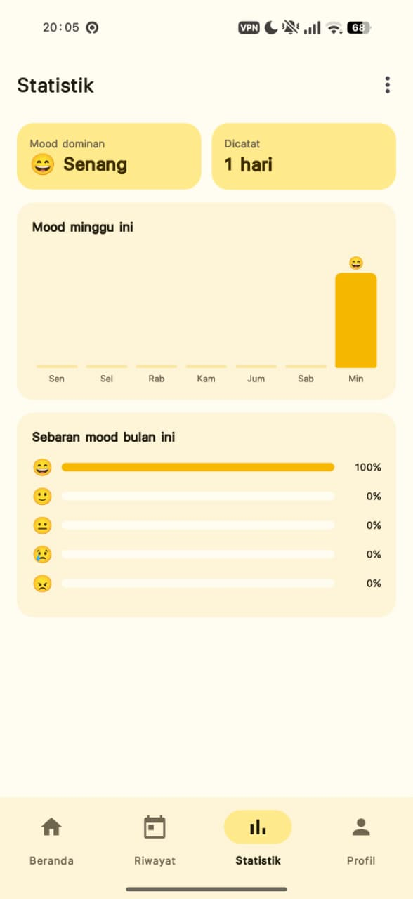
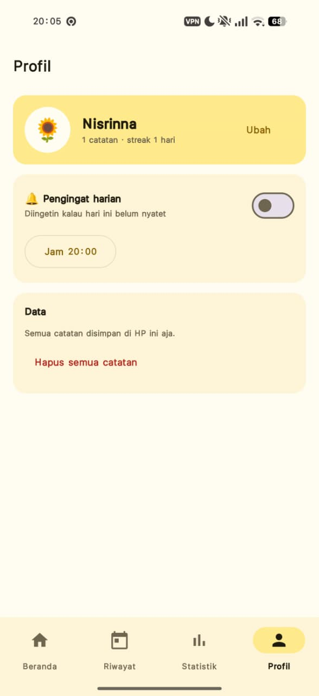
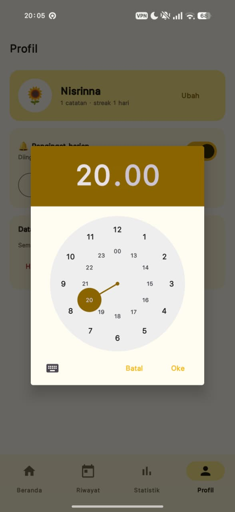

# Tugas 1 -Merancang Antar MUKA (UI) Dasar Aplikasi Mobile

# Moodly - Aplikasi Pencatat Mood Harian

Aplikasi **Moodly** berbasis Android untuk mencatat mood harian, melihat riwayatnya dalam bentuk kalender, dan memantau statistik perasaan dari waktu ke waktu. Dikembangkan menggunakan Kotlin dan XML (Material Design 3) di Android Studio.

## 📱 Fitur & Layar Aplikasi

1. **Layar Sambutan (WelcomeActivity)**: Muncul saat pertama kali membuka aplikasi, meminta nama panggilan pengguna.
2. **Beranda (HomeFragment)**: Sapaan dengan nama pengguna, pilihan 5 mood (Senang, Baik, Biasa, Sedih, Kesal), streak hari berturut-turut, dan 3 catatan terakhir.
3. **Catat Mood (AddMoodActivity)**: Memilih mood, aktivitas yang dilakukan (Kuliah, Teman, Ngopi, dll.), dan menulis catatan. Catatan yang sudah ada bisa diubah atau dihapus.
4. **Riwayat (HistoryFragment)**: Kalender bulanan berisi emoji mood tiap tanggal, detail catatan per tanggal, dan pencarian catatan.
5. **Statistik (StatsFragment)**: Mood dominan, jumlah hari tercatat, grafik mood minggu ini, dan sebaran mood bulan ini / semua waktu.
6. **Profil (ProfileFragment)**: Ubah nama, atur pengingat harian (notifikasi), dan hapus semua catatan.

## 🛠️ Komponen UI yang Digunakan

- **ViewGroup**: LinearLayout (Vertical & Horizontal), FrameLayout, ScrollView, NestedScrollView
- **View Widgets**: TextView, EditText, ImageButton, Button
- **Material Components**: MaterialToolbar, BottomNavigationView, FloatingActionButton, MaterialCardView, Chip & ChipGroup, TextInputLayout, MaterialButton, MaterialSwitch, LinearProgressIndicator, MaterialAlertDialog
- **Navigasi**: Activity, Intent, Fragment
- **Penyimpanan Data**: SharedPreferences (format JSON)
- **Notifikasi**: AlarmManager, BroadcastReceiver, NotificationCompat
- **Resource Management**: strings.xml, colors.xml, themes.xml, drawable (vector icon & shape), menu

## 🚀 Cara Menjalankan Aplikasi

1. Sambungkan HP ke laptop pakai kabel USB, lalu aktifkan **USB Debugging** di HP.
2. Buka terminal di folder project, lalu jalankan:
   ```
   gradlew.bat installDebug
   ```
3. Tunggu sampai muncul tulisan `BUILD SUCCESSFUL`.
4. Buka aplikasi **Moodly** di HP, atau lewat terminal:
   ```
   adb shell am start -n com.contoh.halokotlin/.MainActivity
   ```

## 📸 Tangkapan Layar (Screenshot)

| Layar Sambutan | Beranda (Kosong) | Catat Mood |
| :---: | :---: | :---: |
|  |  |  |

| Beranda (Terisi) | Riwayat (Kalender) | Statistik |
| :---: | :---: | :---: |
|  |  |  |

| Profil | Atur Jam Pengingat |
| :---: | :---: |
|  |  |
